# Rule: Decoupled CI/CD & Database Release Safety

- **Trigger:** Building containers, deploying to staging/test/production, running schema migrations, database seeding
- **Scope:** Full-stack services, backend applications, containerized environments, and cloud deployments

## Core Architectural Invariant
**Never conflate routine code deployment with database/cache resets.** Routine deployments must preserve persistent databases, active user sessions, and test fixtures. Data wipes are dangerous maintenance tasks that must be decoupled into dedicated, guarded workflows.

---

## The 3-Workflow Deployment Standard

```mermaid
flowchart TD
    subgraph Build["1. Build Containers Workflow"]
        B1["Fetch commit"] --> B2["docker compose build"]
        B2 --> B3["Tag :test-<sha> & :test-latest"]
        B3 --> B4["Prune dangling build cache"]
    end

    subgraph Release["2. Release App & Run Migrations"]
        R1["Optional: Build if needed"] --> R2["Pre-release DB snapshot / backup"]
        R2 --> R3["Apply pending schema migrations"]
        R3 --> R4["Ensure / verify BFF / API tokens"]
        R4 --> R5["Zero-downtime rolling container swap"]
        R5 --> R6["Live health-gate check (e.g. /api/health)"]
    end

    subgraph Reset["3. Reset Database & Cache (Guarded)"]
        W1["Require confirm: 'RESET'"] --> W2["Pre-wipe safety snapshot"]
        W2 --> W3["Flush Redis / cache & active sessions"]
        W3 --> W4["Apply current schema migrations"]
        W4 --> W5["Import reference catalogs & templates"]
        W5 --> W6["Seed baseline dev personas & test data"]
        W6 --> W7["Reload application containers"]
    end
```

---

## Operating Invariants

1. **Pre-Release Snapshot First:** Every automated schema migration or database operation MUST trigger an automated snapshot or backup before executing SQL changes (e.g. `pg-backup.sh`). Rollback must be fast and reliable.
2. **Layer Caching on Build:** Build container images with Docker BuildKit layer caching directly on the target host or CI runner. Decoupled builds allow verifying compilation without touching live services.
3. **Additive Schema Migrations Only:** Migrations applied during routine releases must be additive (new nullable columns, new tables, non-destructive indexes). Never apply destructive `DROP` or `TRUNCATE` operations during a deployment.
4. **Guarded Data Wipes:** Reset workflows that wipe cache or seed test fixtures MUST require an explicit, un-automatable confirmation input (such as typing `confirm: "RESET"`).
5. **Mandatory Live Health Gate:** Every deployment pipeline must conclude with a live HTTP health-gate probe verifying service responsiveness, database ping latency, and applied migration count.
