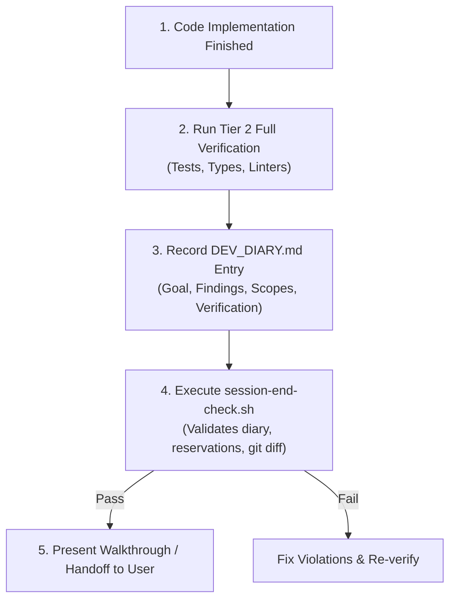

# Rule: Session Completion & Quality Handoff Gate

- **Trigger:** Concluding an AI work turn, preparing a handoff report, or staging a commit
- **Scope:** Universal across all projects and codebases

## Pre-Completion Checklist

Before an agent declares a task complete or prompts the user for review, the following four gates MUST be executed and verified:

---

## 1. Quality & Parity Gate
- **Type Checking:** All affected modules pass strict static analysis without unresolved `any` escapes.
- **Tests:** Targeted and regression suites execute cleanly.
- **Locale Parity:** If user-facing strings or translation keys were touched, run the locale parity check script (`check-locale-parity.sh`) to confirm 100% key schema parity across all languages.

## 2. Developer Diary Entry
- Ensure `.agents/DEV_DIARY.md` contains an entry recording the current session's timestamp, goal, technical findings, modified files, verification evidence, and next steps.

## 3. Workspace Cleanliness
- No temporary scratch scripts or debug mock files left behind outside `.agents/`.
- No lingering `AGENT-RESERVE` or temporary locking markers in source code.

## 4. Git Diff Check
- Execute `git diff --check`.
- Must produce zero warnings or errors (no trailing whitespace, no merge conflict markers, no missing final newlines).

## 5. Automated Handoff Script
- Run `bash .agents/scripts/session-end-check.sh` (or `./scripts/session-end-check.sh`).
- If this script returns non-zero, resolve the failure before handing off to the user.
