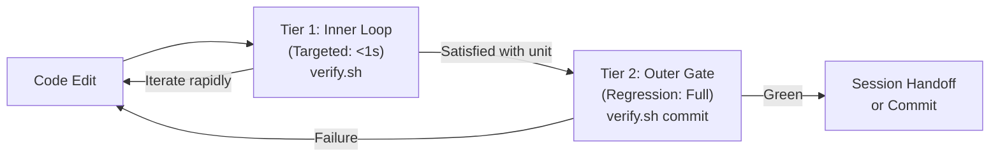

# Rule: Two-Tier Verification Architecture

- **Trigger:** Writing, modifying, debugging, or verifying code
- **Scope:** Universal across all programming languages, frameworks, and projects

## The Problem
Running an entire test suite or full typecheck after every single line edit floods the agent context window with thousands of lines of irrelevant output, slows down iteration loops, and wastes tokens. Conversely, not running full regression checks causes stealth breakage in adjacent modules.

---

## The Two-Tier Model

All projects must structure automated verification into two distinct feedback loops:

### 1. Tier 1: Inner Loop (Targeted Domain Verification)
- **Execution Time:** < 1 second.
- **Scope:** Runs only tests and static checks for the specific domain or module currently being modified (e.g., `verify.sh auth`, `pytest tests/unit/test_service.py`, `bun test api/test/notifications.test.ts`).
- **Goal:** Fast, lightweight feedback during active implementation without context clutter.
- **Rule:** Run the targeted inner check on every iteration.

### 2. Tier 2: Outer Gate (Full Pre-Handoff Regression)
- **Execution Time:** 10 - 60 seconds.
- **Scope:** Complete test suite, full strict typechecking (`tsc --noEmit`, `mypy`), linter (`ruff`, `eslint`), locale parity checks, and git diff cleanliness (`git diff --check`).
- **Goal:** Strict regression prevention before handing off to the user or staging a commit (`verify.sh commit` or `verify.sh full`).
- **Rule:** Never declare a task complete or create a commit without a clean Tier 2 run.

---

## Core Invariants
1. **Never Declare Success Without Executing Checks:** Never claim code works based on assumptions or code inspection alone. You must execute the test or compiler command and inspect the output.
2. **Inspect Logs Before Forming Diagnostic Hypotheses:** Always read error logs and stack traces before modifying code to fix a bug. Never guess column names, types, or endpoints.
3. **Diff Cleanliness:** Always run `git diff --check` before completing to guarantee zero trailing whitespace, merge artifacts, or invalid newlines.
